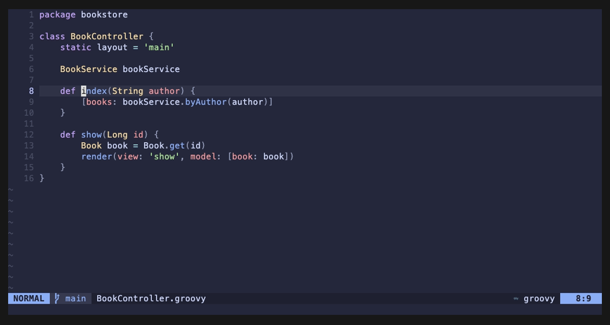

# grails.nvim

Grails support for Neovim: a tree-sitter grammar for GSP (Groovy Server Pages), the client for [grails-language-server](https://github.com/vdassios/grails-language-server), and a small Lua server for Grails navigation that needs no JDK.



## Features

- **GSP grammar**: highlights, folds and injections, HTML in the page text and Groovy in `${ }`, scriptlets and attribute values. [More](docs/grammar.md)
- **grails-language-server client** (`grails_ls`): Groovy and GSP diagnostics, completion, hover, definition and signature help with the project's own Groovy and Grails, GORM, and Grails conventions. `:GrailsInstallServer` downloads it.
- **Lua navigation server** (`grails`): go to definition for views, templates, layouts, assets, controllers and actions, the moment a file opens and with no JDK. See [why two servers](#two-language-servers). [More](docs/lua-server.md)
- **`:GrailsAlternate`**: from a controller action to its view and back, and between artefacts of the same name.
- **Default keymaps** for the commands, only in Grails buffers, never over a key that is already mapped. See [Keymaps](#keymaps).

## Requirements

- Linux or macOS. grails.nvim is Linux and macOS only: nothing is tested on Windows.
- Neovim 0.11.3 or later.
- A Grails project with the Gradle layout, `grails-app/` in each module: Grails 3 or later for the Lua server, Grails 4 or later for `grails_ls` (it reports `failed` on Grails 3's Groovy 2.4).
- The `groovy` and `html` tree-sitter parsers. The server reads Groovy files with the `groovy` parser, and GSP pages inject `html` and `groovy`. Without a parser it needs, the Lua server says so once.
- To build the `gsp` parser: [nvim-treesitter](https://github.com/nvim-treesitter/nvim-treesitter) (`main` branch), or the `tree-sitter` CLI and a C compiler ([without nvim-treesitter](docs/grammar.md#without-nvim-treesitter)).
- For `grails_ls`: `curl` and `sha256sum` or `shasum` (for `:GrailsInstallServer`) and the project's JDK, Java 11 or later (see "Configuration").

`:checkhealth grails` checks these: the parsers, `curl` and the checksum tool, the server jar, and for each open Grails project whether it is trusted and the JDK `grails_ls` would run on.

## Installation

With [lazy.nvim](https://github.com/folke/lazy.nvim):

```lua
{
  'nvim-treesitter/nvim-treesitter',
  branch = 'main',
  -- grails.nvim registers the `gsp` parser with nvim-treesitter, so it must
  -- load first.
  dependencies = { 'vdassios/grails.nvim' },
  build = ':TSUpdate',
  config = function()
    require('nvim-treesitter').install { 'gsp', 'groovy', 'html' }
  end,
},
{
  'vdassios/grails.nvim',
  lazy = false,
  config = function()
    vim.lsp.enable { 'grails', 'grails_ls' }
  end,
},
```

`vim.lsp.enable { 'grails', 'grails_ls' }` turns on both language servers that come with the plugin; you need no other LSP setup. To use only one, enable only that name. Before you use `grails_ls` for the first time, run `:GrailsInstallServer` to download it, then `:GrailsTrust` once in each Grails project you want it to run in (see [Trust](#configuration)).

nvim-treesitter's `main` branch does not start highlighting by itself. If your config does not already do this, start it for GSP:

```lua
vim.api.nvim_create_autocmd('FileType', {
  pattern = 'gsp',
  callback = function()
    vim.treesitter.start()
  end,
})
```

## Two language servers

grails.nvim comes with two language servers. They do different jobs, and they work best together.

- **`grails_ls`** is [grails-language-server](https://github.com/vdassios/grails-language-server), the full server. It compiles your code with the project's own Groovy and Grails, so it knows types, GORM and the methods Grails adds: errors, completion, hover, go to definition. The cost: it needs the project's JDK and a download, and it runs the project's Gradle build, so it takes a few seconds to get ready (longer the first time, while Gradle resolves the project). Because that runs project code, it starts only in projects you have trusted with `:GrailsTrust`.
- **`grails`** is a small server written in Lua that runs inside Neovim. It does one thing: go to definition for the names Grails looks up by convention, such as `render(view: 'show')`, `<g:render template="row"/>`, layouts, assets, and controller and action names. It works the moment a file opens, needs no JDK or download, and never runs project code.

With both enabled, `grails` answers go to definition until `grails_ls` is ready, and wherever `grails_ls` cannot run: without a suitable JDK, when the Gradle build fails, or when you have not enabled it. Once `grails_ls` is ready in a buffer, `grails` stops answering there, so go to definition never gives two results. `grails` attaches only to Groovy and GSP files inside a Grails project, `grails_ls` only to Groovy and GSP source files of a Grails build you trust (never to `build.gradle`, `settings.gradle` or a `Jenkinsfile`).

If you also use [nvim-lspconfig](https://github.com/neovim/nvim-lspconfig) and it has a `grails_ls` config, the two don't clash: grails.nvim's settings are applied on top of nvim-lspconfig's, and your own `vim.lsp.config('grails_ls', { ... })` is applied on top of both.

## Commands

| Command | Default key | Does |
|---|---|---|
| `:GrailsAlternate` | `<localleader>Ga` | From a controller action, open its view. From a view, go to the matching action. From a domain class, controller or service, cycle to the artefact of the same name. |
| `:GrailsReindex` | `<localleader>Gi` | `grails_ls` reads the project's source files again, without Gradle. Run it after changes made outside Neovim that `grails_ls` missed. The Lua server needs nothing: it reads the files on each lookup. |
| `:GrailsInstallServer [tag]` | `<localleader>GI` | Download the grails-language-server jar to `stdpath('data')/grails.nvim/`: from the newest stable release, or the newest pre-release when no stable release has the jar (it says which), or from release `[tag]` (such as `v0.1.2-m6`). The download is checked against the SHA-256 digest GitHub publishes for it and is not installed when it does not match; a release without a digest is installed with a warning. Does nothing when that release is installed; `:GrailsInstallServer!` downloads it again. A running client keeps the old jar until it restarts. |
| `:GrailsReloadProject` | `<localleader>Gr` | `grails_ls` resolves the Gradle project again, ignoring its cache. Run it after a dependency change. |
| `:GrailsDownloadSources` | `<localleader>Gs` | `grails_ls` fetches the sources jars the project's libraries lack, with the project's Gradle, so definition and hover reach library code. Reports how many libraries have sources now. |
| `:GrailsTrust` | none | Trust the current buffer's Grails project, so `grails_ls` may run its Gradle build, and start `grails_ls` for that project's open buffers. Remembered across sessions. |
| `:GrailsUntrust` | none | Stop trusting the current buffer's Grails project and stop its `grails_ls`. |

### Keymaps

The default keys are set only in Groovy and GSP buffers inside a Grails project, as buffer-local mappings. They start with `<localleader>`, which is `\` unless you set `vim.g.maplocalleader`; Neovim maps nothing under it. A default is not set when its key is already mapped (by you or by another plugin), so grails.nvim never replaces a mapping. The same holds for `K` in GSP buffers, which grails.nvim maps to LSP hover so that it never opens `:Man` ([more](docs/grammar.md#gsp-language)).

Each command also has a `<Plug>` mapping: `<Plug>(grails-alternate)`, `<Plug>(grails-reindex)`, `<Plug>(grails-install-server)`, `<Plug>(grails-reload-project)` and `<Plug>(grails-download-sources)`. Map your own key to one, and grails.nvim skips the default key for that command:

```lua
vim.keymap.set('n', '<leader>a', '<Plug>(grails-alternate)', { desc = 'Grails: alternate file' })
```

To turn off all default keys, `K` included, set this before you open a file:

```lua
vim.g.grails_default_mappings = false
```

## Configuration

`after/lsp/grails_ls.lua` starts the server jar on `.groovy` and `.gsp` source files of a Grails build: the root is the nearest directory with `settings.gradle`, `settings.gradle.kts` or `gradlew`, and it must have a module with `grails-app/`. It never starts for `*.gradle` files or a `Jenkinsfile`, nor for a Gradle build without `grails-app/` (such as `buildSrc`). It does not start, and says why once, while the root is not trusted, the jar is missing or there is no usable JDK.

**Trust.** The server runs the project's Gradle build scripts (and its Gradle wrapper) and its AST transformations, so it executes project code. `grails_ls` therefore starts only in a root you have trusted: opening a file of an untrusted Grails project shows one notice naming `:GrailsTrust` and starts no JVM, while the Lua server `grails` keeps working. `:GrailsTrust` adds the project's root to an allowlist in `stdpath('state')/grails/trusted.json` (stored as real paths, so a symlink to a trusted root is trusted too); `:GrailsUntrust` removes it. The client sends `initializationOptions.trusted` from that allowlist, whichever way the client was started.

**JDK.** The server must run on the project's JDK (the one its Gradle build uses): it compiles with the project's Groovy, which reads the JDK's class files with its bundled ASM, so Groovy 2.5 (Grails 4) needs JDK 15 or older. The server's docs have [the table](https://github.com/vdassios/grails-language-server/blob/main/docs/editors.md#install). `grails_ls` picks the JDK for each project root when it starts there, so two projects in one session can run on different JDKs. The first of these wins:

1. `vim.g.grails_ls.java`.
2. `org.gradle.java.home` in the root's `gradle.properties`.
3. `java=<id>` in the root's `.sdkmanrc`: SDKMAN's `$SDKMAN_DIR/candidates/java/<id>` (default `~/.sdkman`).
4. `$JAVA_HOME/bin/java`.
5. `java` from `PATH`.

The project files (2 and 3) are read only once the root is trusted, because they name a program to run. A source that names no usable JDK (a `JAVA_HOME` without `bin/java`, an `.sdkmanrc` JDK that is not installed or an identifier that is not one) is warned about once and skipped. Before the first start on a `java`, the client runs `java -version` once, in the background; it does not start the server, and says why, when there is no JDK behind it (such as macOS's `/usr/bin/java` with no JDK installed) or it is older than Java 11.

```lua
vim.g.grails_ls = {
  java = '/path/to/jdk-11/bin/java', -- default: the project's JDK, as above
  jar = '/path/to/grails-language-server-all.jar', -- default: the one :GrailsInstallServer downloads
}
```

Both are read each time the server starts. To change anything else, such as JVM flags, override the whole command: `vim.lsp.config('grails_ls', { cmd = { 'java', '-Xmx2g', '-jar', require('grails.ls').jar() } })`. With your own `cmd`, the client checks neither the jar nor `java`. `cmd_env`, `cmd_cwd` and `detached` apply to the default command too.

**Server version.** The client warns once when the server is older than the version it is made for (`require('grails.ls').min_server_version`); a server that reports no version is older. Run `:GrailsInstallServer` to update it.

**Status.** The server reports `resolving`, `indexing`, `ready` and `failed`. The client turns them into LSP progress, so `vim.lsp.status()` and progress plugins show them, and notifies a failure with its reason.

## Documentation

- [GSP grammar](docs/grammar.md): what it highlights and injects, building it without nvim-treesitter, known limits, the public code it was checked against
- [Lua navigation server](docs/lua-server.md): what go to definition reaches, known limits
- [Development](docs/development.md): grammar and plugin tests, and the integration spec, which runs the plugin against a server jar when `GRAILS_LS_JAR` and `GRAILS_LS_FIXTURE` are set
- [grails-language-server](https://github.com/vdassios/grails-language-server): features, editors, how it works

## License

Apache-2.0. The GSP token set and the resolution rules follow the [Apache Grails IntelliJ plugin](https://github.com/apache/grails-intellij-plugin); see `NOTICE`.
